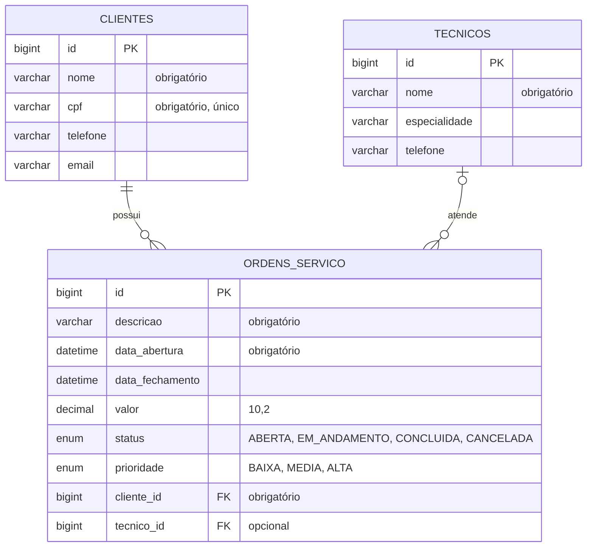

# Sistema de Ordem de Serviço — API REST com Spring Boot

API REST para gerenciar as ordens de serviço (OS) de uma assistência técnica. O cliente traz um equipamento, a empresa abre uma OS, um técnico é atribuído e a OS termina **concluída** ou **cancelada**.

```
ABERTA ──► EM_ANDAMENTO ──► CONCLUIDA
   │             │
   └─────────────┴──────────► CANCELADA
```

Depois de concluída ou cancelada, a OS não pode mais ser alterada.

## Tecnologias

| Tecnologia | Versão |
|---|---|
| Java | 21 |
| Spring Boot | 4.1.2 |
| MySQL |

## Arquitetura

A aplicação usa camadas, e cada camada só conversa com a camada de baixo:

```
Cliente HTTP ──► Controller ──► Service ──► Repository ──► MySQL
(Swagger)        recebe a        aplica as     acessa o banco
                 requisição      regras de     com Spring
                                 negócio       Data JPA
```

As entidades do pacote `model` circulam entre todas as camadas e viram tabelas no banco.

```
src/main/java/com/exemplo/ordemservico/
├── OrdemservicoApplication.java   # classe principal
├── enums/       StatusOS, Prioridade
├── model/       Cliente, Tecnico, OrdemServico
├── repository/  ClienteRepository, TecnicoRepository, OrdemServicoRepository
├── service/     ClienteService, TecnicoService, OrdemServicoService
└── controller/  ClienteController, TecnicoController, OrdemServicoController
```

## Modelo de dados



- Um **cliente** pode ter várias OS, e cada OS pertence a exatamente um cliente.
- Uma OS nasce **sem técnico** e depois recebe um. Um técnico pode atender várias OS.

## Regras de negócio

Cada regra fica num único método, marcado no código com o comentário `// REGRA N`.

| Regra | Descrição | Método |
|---|---|---|
| 1 | Não podem existir dois clientes com o mesmo CPF | `ClienteService.salvar` |
| 2 | A OS só pode ser aberta para um cliente cadastrado | `OrdemServicoService.validarClienteCadastrado` |
| 3 | Ao abrir, a OS recebe a data de abertura e o status `ABERTA` | `OrdemServicoService.abrir` |
| 4 | Uma OS `CONCLUIDA` ou `CANCELADA` não pode mais ser alterada | `OrdemServicoService.validarOsNaoFinalizada` |
| 5 | Ao atribuir um técnico, a OS passa para `EM_ANDAMENTO` | `OrdemServicoService.atribuirTecnico` |
| 6 | Só é possível concluir uma OS que tenha técnico | `OrdemServicoService.validarTecnicoAtribuido` |
| 7 | Ao concluir, a OS recebe valor, data de fechamento e status `CONCLUIDA` | `OrdemServicoService.concluir` |
| 8 | Ao cancelar, a OS recebe data de fechamento e status `CANCELADA` | `OrdemServicoService.cancelar` |
| 9 | Um cliente com OS cadastrada não pode ser excluído *(exercício)* | `ClienteService.validarClienteSemOrdens` |
| 10 | O valor ao concluir uma OS deve ser maior que zero *(exercício)* | `OrdemServicoService.validarValorPositivo` |

## Endpoints

### Clientes — `/clientes`

| Método | Endpoint | Descrição | Regras |
|---|---|---|---|
| GET | `/clientes` | Lista todos os clientes | — |
| GET | `/clientes/{id}` | Busca um cliente | — |
| POST | `/clientes` | Cadastra um cliente (201) | 1 |
| PUT | `/clientes/{id}` | Atualiza nome, telefone e e-mail | — |
| DELETE | `/clientes/{id}` | Exclui um cliente (204) | 9 |

### Técnicos — `/tecnicos`

| Método | Endpoint | Descrição |
|---|---|---|
| GET | `/tecnicos` | Lista todos os técnicos |
| GET | `/tecnicos/{id}` | Busca um técnico |
| POST | `/tecnicos` | Cadastra um técnico (201) |
| PUT | `/tecnicos/{id}` | Atualiza um técnico |
| DELETE | `/tecnicos/{id}` | Exclui um técnico (204) |

### Ordens de serviço — `/ordens`

| Método | Endpoint | Descrição | Regras |
|---|---|---|---|
| GET | `/ordens` | Lista todas as OS | — |
| GET | `/ordens?status=ABERTA` | Filtra por status | — |
| GET | `/ordens/{id}` | Busca uma OS | — |
| GET | `/ordens/cliente/{clienteId}` | Lista as OS de um cliente | — |
| GET | `/ordens/prioridade/{prioridade}` | Filtra por prioridade *(exercício)* | — |
| POST | `/ordens` | Abre uma OS (201) | 2 e 3 |
| PUT | `/ordens/{id}/tecnico/{tecnicoId}` | Atribui o técnico | 4 e 5 |
| PUT | `/ordens/{id}/concluir?valor=250.00` | Conclui a OS | 4, 6, 7 e 10 |
| PUT | `/ordens/{id}/cancelar` | Cancela a OS | 4 e 8 |

## Como executar

### Pré-requisitos

- **JDK 21**
- **MySQL 8** rodando na porta 3306

Não é preciso instalar o Maven, porque o projeto traz o wrapper (`mvnw`).

### 1. Configurar o banco com o arquivo `.env`

As senhas do banco não ficam no código. 

```properties
DB_HOST=localhost
DB_PORT=3306
DB_NAME=ordemservicodb
DB_USERNAME=root
DB_PASSWORD=senha do banco
```

### 2. Documentação interativa (Swagger)

Acesse **http://localhost:8080/swagger-ui.html** para ver e testar todos os endpoints pelo navegador.

## Exemplos de requisição

**Cadastrar cliente:** `POST /clientes`

```json
{
  "nome": "Maria Souza",
  "cpf": "123.456.789-00",
  "telefone": "(41) 99999-0000",
  "email": "maria@email.com"
}
```

**Cadastrar técnico:** `POST /tecnicos`

```json
{
  "nome": "João Lima",
  "especialidade": "Notebooks",
  "telefone": "(41) 98888-1111"
}
```

**Abrir OS:** `POST /ordens` (o cliente vai só com o id)

```json
{
  "descricao": "Notebook não liga",
  "prioridade": "ALTA",
  "cliente": { "id": 1 }
}
```

Resposta `201`:

```json
{
  "id": 1,
  "descricao": "Notebook não liga",
  "dataAbertura": "2026-11-10T23:30:00",
  "dataFechamento": null,
  "valor": null,
  "status": "ABERTA",
  "prioridade": "ALTA",
  "cliente": { "id": 1, "nome": "Maria Souza", "...": "..." },
  "tecnico": null
}
```

## Roteiro de testes

| Teste | Requisição | Regra | Resultado esperado |
|---|---|---|---|
| 6.1 | `POST /clientes` | — | 201, cliente 1 |
| 6.2 | `POST /clientes` (mesmo CPF) | 1 | 400, CPF já existe |
| 6.3 | `POST /tecnicos` | — | 201, técnico 1 |
| 6.4 | `POST /ordens` com cliente 99 | 2 | 404, cliente não encontrado |
| 6.5 | `POST /ordens` com cliente 1 | 3 | 201, `ABERTA` e data de abertura |
| 6.6 | `PUT /ordens/1/concluir?valor=250.00` | 6 | 400, falta técnico |
| 6.7 | `PUT /ordens/1/tecnico/1` | 5 | 200, `EM_ANDAMENTO` |
| 6.8 | `PUT /ordens/1/concluir?valor=250.00` | 7 | 200, `CONCLUIDA`, valor e data |
| 6.9 | `PUT /ordens/1/cancelar` | 4 | 400, OS já `CONCLUIDA` |
| 6.10 | `POST /ordens` e `PUT /ordens/2/cancelar` | 8 | 200, `CANCELADA` e data |
| 9 | `DELETE /clientes/1` | 9 | 400, cliente possui OS |
| 10 | `PUT /ordens/{id}/concluir?valor=0` (OS com técnico) | 10 | 400, valor deve ser maior que zero |
| — | `GET /ordens/prioridade/ALTA` | — | 200, OS de prioridade alta |

## Diferenças em relação ao material de aula

- **Banco de dados:** usei **MySQL** no lugar do PostgreSQL. O código Java é o mesmo, só mudam o driver no `pom.xml` e a URL de conexão.
- **Senhas:** saem do arquivo `.env`.
- **Swagger** documentação da api.
